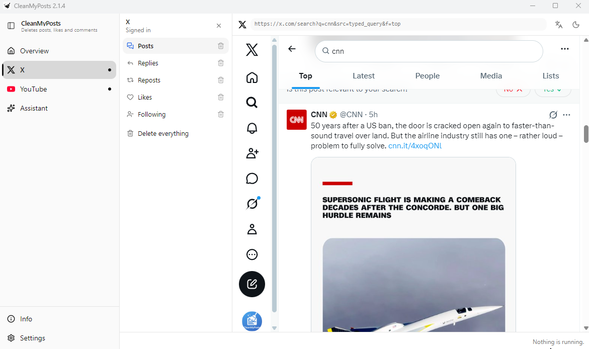
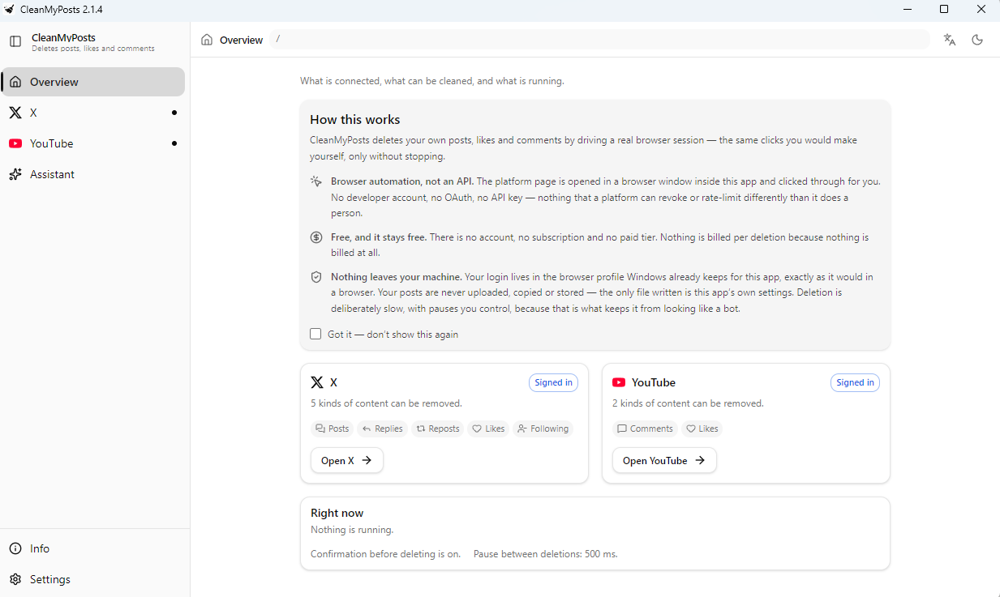
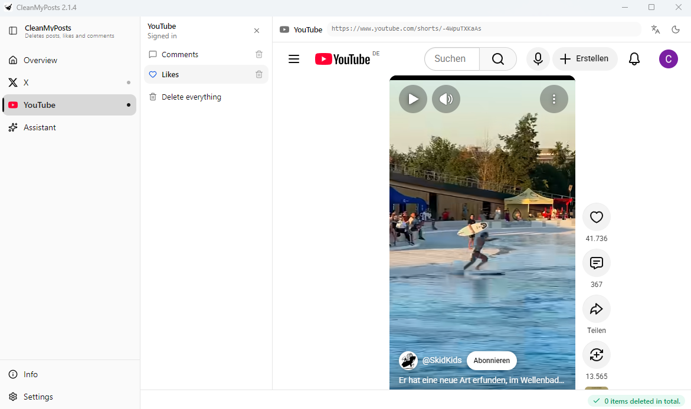
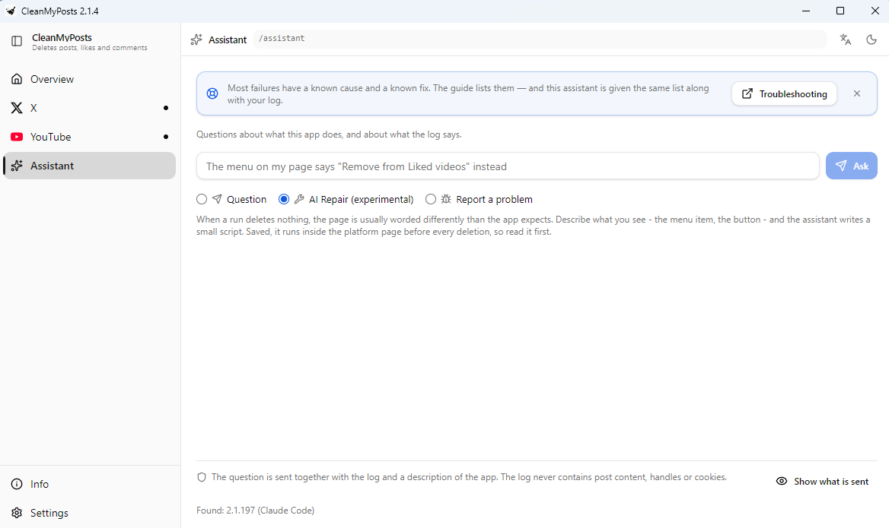

<div align="center">

<picture>
  <source media="(prefers-color-scheme: dark)" srcset="./assets/banner-dark.png">
  
</picture>

### Delete your X and YouTube history in bulk — free, private, no API key.

Posts, replies, reposts, likes and followings on X. Comments and liked videos on YouTube.<br>
Years of it, gone in one click instead of one menu at a time.

[](https://github.com/thorstenalpers/CleanMyPosts/releases/latest)
[](https://chromewebstore.google.com/detail/cleanmyposts/klkjiihehilemkhhdnfphkildcakadbi)
[](https://addons.mozilla.org/en-US/firefox/addon/cleanmyposts/)



</div>

---

## Why CleanMyPosts

Neither X nor YouTube lets you delete in bulk. Every post, like and comment sits behind its own
menu and its own confirmation — fine for one mistake, hopeless for ten years of posting.

|                                 | CleanMyPosts | Deleting by hand | Official API         |
| ------------------------------- | :----------: | :--------------: | -------------------- |
| Bulk deletion                   |      ✅      |        ❌        | ✅                   |
| Free                            |      ✅      |        ✅        | ❌ X charges monthly |
| No daily limit                  |      ✅      |        ✅        | ❌ YouTube quota     |
| No developer account or API key |      ✅      |        ✅        | ❌                   |
| Your data stays on your machine |      ✅      |        ✅        | depends on the tool  |

- 🆓 **Free and open source.** MIT licensed. No subscription, no account, no paywall.
- 🔒 **Private.** There is no server. You sign in to X and Google directly, in your own
  session, and nothing about you leaves your machine.
- 🖱️ **No API, no token.** It clicks the same buttons you would — just without stopping.
- 🐢 **Paced like a human.** Deliberate pauses between deletions keep the platforms from
  flagging you as a bot. You can tune them.
- 🌍 **Eleven languages.** English, German, Spanish, French, Hindi, Italian, Japanese,
  Portuguese, Arabic, Russian and Chinese — and it works even if X or YouTube are shown in
  another language.

---

## What it deletes

| Platform    | Lists                                           |
| ----------- | ----------------------------------------------- |
| **X**       | Posts · Replies · Reposts · Likes · Followings  |
| **YouTube** | Comments · Liked videos (and disliked ones too) |

For each list you can **look first**, **empty just that one**, or hit **Delete everything** to
clear all of them in one run. Every delete asks for confirmation first, and the confirmation
names exactly what is about to go.



---

## Get started in 3 steps

### 🪟 Windows app

1. [Download the installer](https://github.com/thorstenalpers/CleanMyPosts/releases/latest)
   and run it. Windows may warn about an unverified publisher — choose _Run anyway_.
2. Sign in to X or YouTube inside the app.
3. Press **Delete everything** — or pick a single list.

Needs Windows 10 (2004) or later, 64-bit. Nothing else to install.

### 🧩 Chrome or Firefox extension

Not on Windows, or rather not install an app? The extension uses the very same delete engine,
right in the tab you already have open.

1. Install it from the [Chrome Web Store](https://chromewebstore.google.com/detail/cleanmyposts/klkjiihehilemkhhdnfphkildcakadbi)
   or [Firefox Add-ons](https://addons.mozilla.org/en-US/firefox/addon/cleanmyposts/).
2. Open X or YouTube and sign in.
3. Click the CleanMyPosts icon in the toolbar and pick what to delete.

> [!WARNING]
> **Deletions are permanent.** Neither platform offers a way back, and CleanMyPosts keeps no
> copy. Look at a list before you empty it.

---

## See it in action

**YouTube** — comments and liked videos in a single run.



---

## 🤖 Optional: the built-in assistant

X and YouTube change their pages without warning. When a list suddenly stops deleting, the
assistant helps:

- 🩹 **Fix it yourself** — hand it the log of a failed run and it writes a short plan of clicks,
  waits and scrolls. You read every step, **Check first** counts what it would touch, and
  **Keep as action** saves it next to the built-in lists.
- 🐞 **Report a bug** — it turns the log into a ready-to-file GitHub issue. You press submit.
- 💬 **Ask a question** — about a run, a setting, or what just happened.

It runs on [Claude Code](https://claude.com/claude-code) if installed, or on a provider of
your choice with your own API key. You see the exact text before anything is sent, and posts,
handles and addresses are stripped out first. **Without it the app is complete** — the
assistant simply does not show up.

<details>
<summary>How the assistant stays safe</summary>

A plan is not code. It is a fixed vocabulary of clicks, waits, scrolls, navigation and typing,
checked against a schema before anything runs — so a wrong answer can only ask for things the
delete engine could already do, and only on the platform's own pages. Nothing a model wrote is
ever evaluated inside your signed-in session.

Asking for a plan also sends a skeleton of the open page: tags, test ids and button labels,
with every post, handle and address removed in the browser before it goes anywhere. The
preview is assembled from the same functions that build the request, so it cannot drift from
what is actually sent. The settings list every plan you kept with the day you kept it, and the
assistant can be switched off entirely.



</details>

---

## ❓ FAQ

<details>
<summary><b>Will my account get banned?</b></summary>

CleanMyPosts paces itself like a person and works in your normal session. Still, both
platforms restrict automated access in their terms, and the consequence would fall on your
account. If a run gets throttled, raise the pauses in **Settings → Timing** and wait a few
minutes. You use it at your own risk.

</details>

<details>
<summary><b>Do you see my password or my data?</b></summary>

No. There is no server of ours. You sign in on X's and Google's own pages; the app only keeps
your preferences and the browser profile that keeps you signed in, on your own disk under
`%AppData%` and `%LocalAppData%`.

</details>

<details>
<summary><b>Can I undo a deletion?</b></summary>

No. Deletions are permanent on the platform's side, and CleanMyPosts keeps no copy.

</details>

<details>
<summary><b>I'm on macOS or Linux.</b></summary>

Use the [Chrome](https://chromewebstore.google.com/detail/cleanmyposts/klkjiihehilemkhhdnfphkildcakadbi)
or [Firefox](https://addons.mozilla.org/en-US/firefox/addon/cleanmyposts/) extension, or the
[console scripts](#-without-installing-anything-console-scripts) below.

</details>

<details>
<summary><b>Something isn't working.</b></summary>

See [Troubleshooting](#-troubleshooting). If it is still broken, update to the
[latest release](https://github.com/thorstenalpers/CleanMyPosts/releases/latest) and
[open an issue](https://github.com/thorstenalpers/CleanMyPosts/issues) with the log — the
assistant can write it for you.

</details>

---

## 🧟 Without installing anything: console scripts

Every delete action is also published as a single readable script, generated from the app's
own engine — so a fix in the app is a fix here too.

<details>
<summary>Show steps and scripts</summary>

1. Open the page for the list you want to clear and sign in. Replace `USERNAME` with your X
   handle, without the `@`.
2. Download the script and read it — you are about to run it in your signed-in account, and it
   is unminified for exactly that reason.
3. Press <kbd>F12</kbd>, open the **Console** tab, paste the whole file and press
   <kbd>Enter</kbd>.
4. It starts immediately and reports each step. Close the tab to stop it.

The two waits at the top of each file are the brake against the platform treating your session
as automation. Raising them is always safe; lowering them is what gets a session flagged.

| List             | Open this page                                                                           | Script                                                                                                                                                     |
| ---------------- | ---------------------------------------------------------------------------------------- | ---------------------------------------------------------------------------------------------------------------------------------------------------------- |
| Posts            | [`x.com/search?q=from:USERNAME`](https://x.com/search?q=from%3AUSERNAME&src=typed_query) | [cleanmyposts-x-delete-posts.js](https://github.com/thorstenalpers/CleanMyPosts/releases/latest/download/cleanmyposts-x-delete-posts.js)                   |
| Replies          | [`x.com/USERNAME/with_replies`](https://x.com/USERNAME/with_replies)                     | [cleanmyposts-x-delete-replies.js](https://github.com/thorstenalpers/CleanMyPosts/releases/latest/download/cleanmyposts-x-delete-replies.js)               |
| Reposts          | [`x.com/USERNAME`](https://x.com/USERNAME)                                               | [cleanmyposts-x-delete-reposts.js](https://github.com/thorstenalpers/CleanMyPosts/releases/latest/download/cleanmyposts-x-delete-reposts.js)               |
| Likes            | [`x.com/USERNAME/likes`](https://x.com/USERNAME/likes)                                   | [cleanmyposts-x-delete-likes.js](https://github.com/thorstenalpers/CleanMyPosts/releases/latest/download/cleanmyposts-x-delete-likes.js)                   |
| Following        | [`x.com/USERNAME/following`](https://x.com/USERNAME/following)                           | [cleanmyposts-x-delete-following.js](https://github.com/thorstenalpers/CleanMyPosts/releases/latest/download/cleanmyposts-x-delete-following.js)           |
| YouTube comments | [`myactivity.google.com`](https://myactivity.google.com/page?page=youtube_comments)      | [cleanmyposts-youtube-delete-comments.js](https://github.com/thorstenalpers/CleanMyPosts/releases/latest/download/cleanmyposts-youtube-delete-comments.js) |
| Liked videos     | [`youtube.com/playlist?list=LL`](https://www.youtube.com/playlist?list=LL)               | [cleanmyposts-youtube-delete-likes.js](https://github.com/thorstenalpers/CleanMyPosts/releases/latest/download/cleanmyposts-youtube-delete-likes.js)       |

</details>

---

## 🩺 Troubleshooting

Start with the app's **Log** in the sidebar — or hand it to the assistant, which knows this
list too.

<details>
<summary>Common problems and fixes</summary>

| Symptom                                                                                 | Why                                                                                                                                    | What to do                                                                                                                                                                                                              |
| --------------------------------------------------------------------------------------- | -------------------------------------------------------------------------------------------------------------------------------------- | ----------------------------------------------------------------------------------------------------------------------------------------------------------------------------------------------------------------------- |
| Nothing is deleted, and the log ends with _"No scroll change; assuming no more posts."_ | The page had nothing to act on: you are signed out, or the profile shown is not yours.                                                 | Check the dot next to the platform in the sidebar. If it is dim, sign in inside the app's browser pane and start the action again.                                                                                      |
| A run deletes a handful of items and then stops                                         | The platform is throttling the session — it has decided the clicking looks automated.                                                  | Raise **Settings → Timing**: _between deletions_ to 1500 ms or more, _after a page loads_ to 5000 ms. Then wait a few minutes before the next run. Lower values are what get a session flagged.                         |
| The browser pane stays blank or white                                                   | The WebView2 runtime is missing, or the platform answered with an interstitial (consent, captcha, re-login).                           | Install the [Evergreen WebView2 runtime](https://developer.microsoft.com/microsoft-edge/webview2/) and restart. If it is an interstitial, click through it once by hand — the session is yours, the app only drives it. |
| A cookie banner sits over everything                                                    | The app clicks consent banners away by itself, preferring the _reject_ button, but a wording it has never seen gets through.           | Dismiss it once by hand; the choice is stored in the same browser profile and does not come back. Please report the wording so it can be added.                                                                         |
| _"Deletion failed."_ immediately, on every item                                         | The platform changed its markup, so the buttons the engine looks for are no longer where they were.                                    | Update to the [latest release](https://github.com/thorstenalpers/CleanMyPosts/releases/latest) first. If that does not fix it, this is a real bug — report it with the log.                                             |
| Some likes or followings survive several runs                                           | Not everything is reachable from the list: protected accounts, items behind _Show more_, and posts that were already gone server-side. | Run the action once more. What is left after two clean runs belongs in a bug report.                                                                                                                                    |
| YouTube comments cannot be reached                                                      | My Activity asks for the Google sign-in again, per session.                                                                            | Open the YouTube pane, sign in, and start the action again.                                                                                                                                                             |
| _Check for updates_ reports nothing                                                     | Updates only work in the installed build, and the check needs network access.                                                          | Compare your version on the **Info** page with the [latest release](https://github.com/thorstenalpers/CleanMyPosts/releases/latest) and install it manually if they differ.                                             |

</details>

---

## 🧑‍💻 For developers

<details>
<summary>Build from source, run the tests, load the extension unpacked</summary>

Requires the [Rust toolchain](https://rustup.rs/) and [Node.js 24+](https://nodejs.org/).

```bash
npm ci
npm run build
npm run start
```

`npm run build` before the first `npm run start` is not optional. The Rust crate compiles
the delete engine into itself with `include_str!("../../dist/content/content.js")`, and
`npm run start` does not produce that file — it runs Vite's dev server, which serves the
interface and nothing else. The same applies after any change under `src/lib/engine/`: the app
keeps running the bundle it was compiled with until it is rebuilt.

Build the installer:

```bash
npm run app:build
```

Work on the UI alone in the browser, against an in-memory mock host:

```bash
npm run dev
```

Checks and tests:

```bash
npm run lint
npm run check
npm run test
npm run test:e2e
cargo test --manifest-path src-tauri/Cargo.toml --lib
```

`npm run test:e2e` builds the engine bundle first and runs it in real Chromium against saved
page markup — never against the live sites, so nothing is deleted for real.

**Extension, unpacked:** download the build from
[Releases](https://github.com/thorstenalpers/CleanMyPosts/releases) or run
`npm run build:extension`, then:

- **Chrome:** `chrome://extensions`, turn on Developer mode, _Load unpacked_, pick the `chrome`
  folder.
- **Firefox:** `about:debugging#/runtime/this-firefox`, _Load Temporary Add-on_, pick the
  `manifest.json` inside the `firefox` folder. Temporary add-ons are gone on restart.

The extension injects the same `src/lib/engine/` as the app, so a selector fixed for one is
fixed for both. [extension/README.md](./extension/README.md) has the rest.

Architecture, the UI↔host bridge and the design rules live under
[`.agents/docs/`](.agents/docs/) — start at [AGENTS.md](AGENTS.md).

</details>

---

## 🤝 Contributing

Contributions are welcome. Read the [contributing guidelines](CONTRIBUTING.md), ideally open an
issue first, then send a pull request. Found a bug?
[Report it here](https://github.com/thorstenalpers/CleanMyPosts/issues).

If CleanMyPosts saved you an afternoon of clicking, a ⭐ helps others find it.

---

## ⚠️ Disclaimer

This tool automates a web browser to delete your own content, in your own signed-in session.
Deletions are permanent. Automation may conflict with the platforms' terms of use, and the
consequence would fall on your account rather than on this software — use it at your own
risk. Not affiliated with X Corp. or Google. Provided as-is under the MIT licence, without
warranty of any kind.
